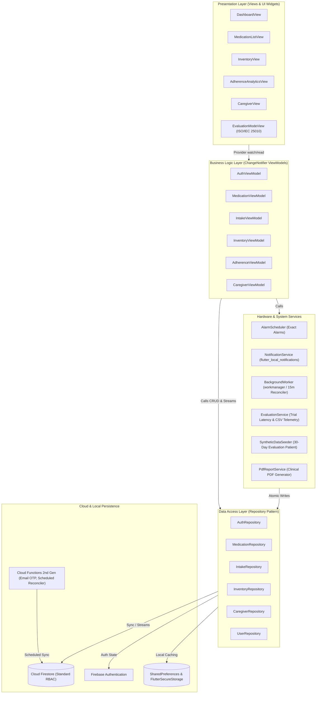

# RemedyTrack System Architecture (MVVM + Repository Pattern)

## Overview
RemedyTrack is developed for the **Laguna University Capstone Project** and evaluated under the **ISO/IEC 25010 Product Quality Model** (specifically evaluating Functional Suitability, Reliability, and Usability).

The application strictly implements the **Model-View-ViewModel (MVVM)** architectural pattern combined with the **Repository Pattern** to decouple user interface rendering from business logic, data persistence, and background hardware orchestration.

---

## Architectural Layering

---

## Component Responsibilities

| Architectural Layer | Components | Role & Responsibilities |
| :--- | :--- | :--- |
| **Presentation Layer (UI)** | `DashboardView`, `MedicationListView`, `InventoryView`, `AdherenceAnalyticsView`, `CaregiverView`, `EvaluationModeView` | Declarative Flutter widgets styled with the Catppuccin color palette. Observes ViewModel states (`loading`, `empty`, `error`, `data`) and renders responsive mobile layouts (Android API 26+ / iOS 14+). Enforces caregiver read-only mode dynamically. |
| **ViewModel Layer (Logic)** | `AuthViewModel`, `MedicationViewModel`, `IntakeViewModel`, `InventoryViewModel`, `AdherenceViewModel`, `CaregiverViewModel` | State containers extending `ChangeNotifier`. Mediates UI actions, enforces business rules (e.g. tablet-only inventory arithmetic, duplicate dose prevention, 60-minute missed reconciliations), and exposes clean UI observables. |
| **Hardware & Services** | `AlarmScheduler`, `NotificationService`, `BackgroundWorker`, `EvaluationService`, `SyntheticDataSeeder`, `PdfReportService` | Native OS interop: schedules `SCHEDULE_EXACT_ALARM`, handles lock-screen actions (`Taken`, `Skip`, `Snooze`), runs periodic background reconciliation every 15 minutes, and records ISO/IEC 25010 trial latency telemetry. |
| **Repository Layer** | `FirebaseMedicationRepository`, `FirebaseIntakeRepository`, `FirebaseInventoryRepository`, `FirebaseCaregiverRepository`, `Mock*` equivalents | Abstracts data persistence behind clean Dart interfaces. Handles network failures via `retryWithBackoff`, translates raw exceptions via `ErrorMapper`, and enables seamless switching between Cloud Firestore and mock in-memory stores. |
| **Backend & Cloud** | Google Cloud Firestore, Firebase Auth, Cloud Functions (Node 20+ TypeScript) | Provides real-time synchronization, server-side HMAC-SHA256 Email OTP challenges, and least-privilege security rules (RBAC). |

---

## Error Handling & Observability Flow

All repository read/write interactions are wrapped with:
1. **`retryWithBackoff`**: Exponential backoff (1s, 2s, 4s, 8s) for transient network timeouts and SocketExceptions.
2. **`ErrorMapper`**: Centralized mapper converting platform/Firebase exceptions into strongly typed `AppException` instances (`NetworkException`, `AuthException`, `PermissionDeniedException`, etc.) preventing raw stack traces or internal leaks to the UI.
3. **Crashlytics Scrubbing**: In production release builds, all PII (patient names, medication names, dosages) is scrubbed, recording only sanitized machine error codes and opaque UIDs.

