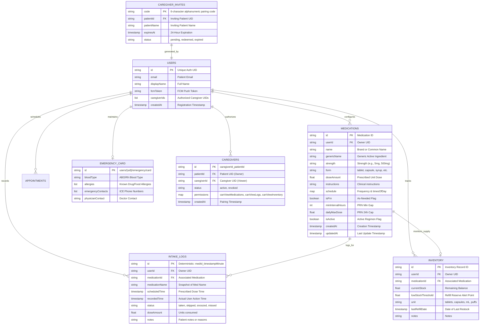

# RemedyTrack Data Model & Entity-Relationship Diagram (ERD)

## Overview
RemedyTrack utilizes **Cloud Firestore** as a NoSQL document database. To guarantee multi-tenant security, strict user isolation, and role-based caregiver access, each document in the patient domain carries an immutable `userId` reference.

All data structures comply with the **Philippine Data Privacy Act of 2012 (RA 10173)**, treating health regimens and intake logs as Sensitive Personal Information (SPI).

---

## Entity-Relationship Diagram (ERD)

---

## Firestore Collection Schema Dictionary

### 1. `users/{userId}`
- **Purpose**: Core patient identity document.
- **Security**: Readable/writable only by authenticated owner. Active caregivers in `caregiverIds` have read permissions.
- **Fields**:
  - `id`: `String` (Firebase Auth UID)
  - `email`: `String` (RFC 5322 formatted email)
  - `displayName`: `String` (Max 100 characters)
  - `caregiverIds`: `List<String>` (UIDs of authorized active caregivers)
  - `createdAt`: `Timestamp`

### 2. `medications/{medicationId}`
- **Purpose**: Prescribed medication regimens and dosage rules.
- **Security**: Owner read/write. Active caregivers read-only.
- **Key Fields**:
  - `form`: `String` (`tablet`, `capsule`, `syrup`, `inhaler`, `injection`, `drops`, `topical`).
  - `schedule`: `Map` containing `frequency` (`daily`, `specificWeekdays`, `everyXDays`, `cycleBased`), `timesOfDay` (`List<String>` HH:mm), and `startDate`.
  - `isPrn`: `Boolean` flag enabling PRN safe-guard arithmetic (`minIntervalHours` and `dailyMaxDose`).

### 3. `intake_logs/{logId}`
- **Purpose**: Immutable and reconcilable historical audit trail of doses.
- **Deterministic ID Formula**: `${medicationId}_${scheduledTime.millisecondsSinceEpoch ~/ 60000}`.
- **Status Enum**: `taken`, `skipped`, `snoozed`, `missed`.

### 4. `inventory/{itemId}`
- **Purpose**: Medication stock balance and refill reserve tracking.
- **Arithmetic Invariant**: Decremented atomically ONLY for dosage forms `tablet` and `capsule` upon `taken` doses. Skipped and missed doses never alter stock.

### 5. `caregivers/{relationshipId}`
- **Purpose**: Bi-directional, revocable link establishing caregiver authorization.
- **Document ID**: `${caregiverUid}_${patientUid}`.
- **Status**: `active` or `revoked`. Revocation immediately disables caregiver Firestore access.

### 6. `caregiver_invites/{code}`
- **Purpose**: Ephemeral 24-hour pairing challenge for caregiver onboarding.
- **Code Format**: 6-character cryptographically secure uppercase alphanumeric string. Single-use only.

