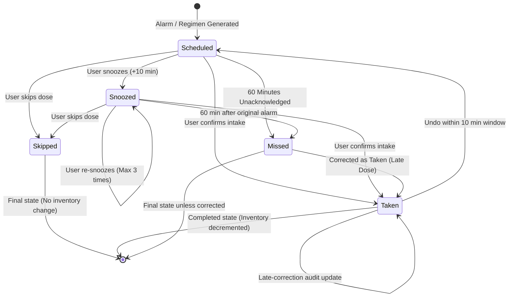

# RemedyTrack Dose State Machine & Transition Invariants

## Overview
To satisfy the requirements of the **Laguna University Capstone Project**, the lifecycle of a medication dose is governed by a formal, deterministic state machine (`lib/core/state/dose_state_machine.dart`).

The state machine strictly models patient adherence behavior, automated time-window reconciliation, and inventory side effects.

---

## State Transition Diagram

---

## Complete State Transition Table

| Source State | Event Trigger | Guard Condition | Target State | Inventory Side Effect | Adherence Impact |
| :--- | :--- | :--- | :--- | :--- | :--- |
| `scheduled` | `take` | Valid dose amount | `taken` | **Atomic decrement** (if tablet/capsule) | Positive (+100%) |
| `scheduled` | `skip` | None | `skipped` | **No change** | Neutral / Preserved |
| `scheduled` | `snooze` | `snoozeCount < 3` | `snoozed` | **No change** | Pending |
| `scheduled` | `reconcileMissed` | `now >= scheduledTime + 60m` | `missed` | **No change** | Negative (0%) |
| `snoozed` | `take` | Valid dose amount | `taken` | **Atomic decrement** (if tablet/capsule) | Positive (+100%) |
| `snoozed` | `skip` | None | `skipped` | **No change** | Neutral / Preserved |
| `snoozed` | `snooze` | `snoozeCount < 3` | `snoozed` | **No change** | Pending |
| `snoozed` | `reconcileMissed` | `now >= scheduledTime + 60m` | `missed` | **No change** | Negative (0%) |
| `taken` | `undo` | `within 10 minutes of intake` | `scheduled` | **Atomic restore** (re-increments stock) | Resets to pending |
| `missed` | `correctAsTaken` | Explicit patient correction | `taken` | **Atomic decrement** (if tablet/capsule) | Corrected (+100%) |

---

## Key Thesis Invariants

### 1. 60-Minute Missed Dose Reconciliation
Any scheduled dose that remains unacknowledged (neither taken nor skipped) for **60 minutes** past its scheduled alarm time automatically transitions to the `missed` state.
- **Client-Side Trigger**: Evaluated on app launch and whenever the dashboard regains focus.
- **Background Worker Trigger**: Executed periodically every 15 minutes via `BackgroundWorker` (utilizing Android `WorkManager`).
- **Cloud Function Trigger**: Scheduled every 15 minutes via Cloud Scheduler (`scheduledMissedDoseReconciliation`).

### 2. Form-Restricted Automated Inventory Arithmetic
Automated inventory decrement is **strictly restricted** to unit-based solid oral dosage forms:
- **Allowed Forms**: `tablet`, `capsule`.
- **Excluded Forms**: `syrup`, `inhaler`, `injection`, `topical`, `drops`.
Non-tablet/capsule items display clear instructional warnings ("Non-standard unit: Manual stock tracking required") and their balances are never altered automatically.

### 3. Duplicate Dose & Stacking Guard Rails
To protect patients from accidental overdose:
- **Duplicate Dose Protection**: Tapping "Take" for a dose that was already confirmed within the same schedule window is blocked.
- **Rapid Dose Stacking Guard**: If the same medication was logged as taken within the last 15 minutes, a confirmation dialog warns the patient of potential dose stacking before recording.

