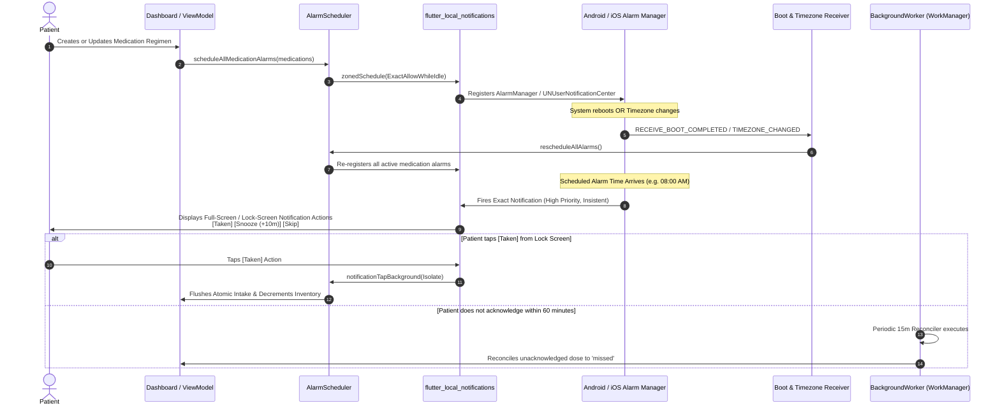

# RemedyTrack Alarm Scheduling & Notification Architecture

## Overview
Reliable medication adherence requires alarms to sound at the exact second scheduled, regardless of Android Doze mode, iOS background execution restrictions, app updates, or device reboot.

RemedyTrack implements a fault-tolerant alarm architecture compliant with **Google Play Exact Alarm Policies** and **Philippine RA 10173 (Privacy by Design)**.

---

## Alarm Scheduling & Firing Sequence

---

## Operating System & Policy Declarations

### 1. Google Play Exact Alarm Policy (Android 12, 13, 14+)
- **Selected Permission**: `android.permission.SCHEDULE_EXACT_ALARM`.
- **Policy Justification**: RemedyTrack is classified under **Health & Medication Tracking / Reminders**.
- **Play Console Declaration**: Under Google Play's Exact Alarm Policy, medication reminders are an approved use case because missing a timely dose represents a direct health risk to patients managing chronic conditions (e.g., hypertension, diabetes).
- **Graceful Degradation**: If the user revokes exact alarm permission in Android settings, RemedyTrack detects the state via `Permission.scheduleExactAlarm.isGranted`, activates inexact windowed alarms, and displays a yellow diagnostic banner in the app prompting the user to re-enable exact alarms.

### 2. Device Reboot & Battery Optimization Rescheduling
- **`RECEIVE_BOOT_COMPLETED`**: Android automatically clears alarms when the device powers down. The app registers a broadcast receiver in `AndroidManifest.xml` that catches boot completion and automatically re-populates the exact alarm table from local persistence.
- **Battery Saver / Doze Mode**: All alarms are registered using `androidAllowWhileIdle: true` and `AlarmClock` mode where applicable, ensuring alarms break through Android Doze mode.

### 3. iOS 14+ Rolling Window Scheduler
- **iOS 64-Notification Limit**: iOS enforces a strict operating system limit of 64 scheduled local notifications per application.
- **Rolling Window Architecture**: RemedyTrack generates notifications only for a rolling 7-day window. Whenever the user opens the application or an intake is logged, the window advances forward, guaranteeing the app never exhausts iOS's 64-notification threshold.

### 4. RA 10173 Privacy Compliance for Notifications
- **Default Notification Body**: To prevent sensitive health disclosures to bystanders viewing the patient's lock screen, notification titles and bodies default to:
  - *Title*: "RemedyTrack Reminder"
  - *Body*: "It is time to take your scheduled medication."
- Medication names and strengths are excluded by default unless the patient explicitly toggles "Display Medication Names on Lock Screen" in Privacy Settings.

