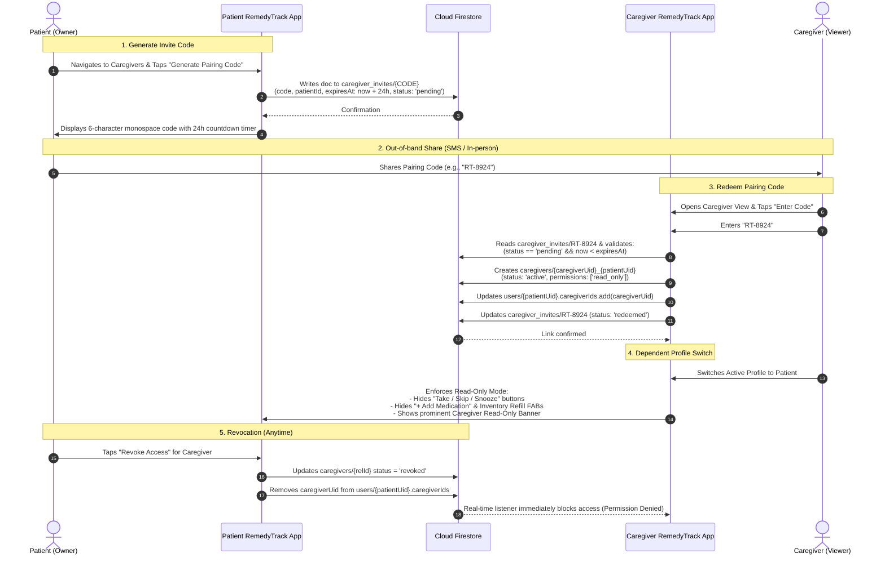

# RemedyTrack Caregiver Linking & RBAC Architecture

## Overview
RemedyTrack features a secure, **Role-Based Access Control (RBAC)** caregiver delegation flow designed to allow family members and professional caregivers to monitor patient adherence and supply levels without compromising data integrity.

The system enforces:
1. **Single-Use 6-Digit Pairing Codes** expiring in 24 hours.
2. **Bi-Directional Relationship Verification**.
3. **Strict Read-Only Enforcement** both at the presentation layer and the database layer (Firestore Security Rules).
4. **Immediate Revocation** at any time by the patient.

---

## Caregiver Pairing Sequence Diagram

---

## Role-Based Access Control (RBAC) Guarantees

| Capability | Patient (Owner) | Active Caregiver (Viewer) | Revoked Caregiver |
| :--- | :---: | :---: | :---: |
| **View Medication Regimens** | Allowed | **Allowed (Read-Only)** | Denied |
| **Add / Edit / Delete Medications** | Allowed | **Denied** | Denied |
| **View Intake Logs & Adherence Charts** | Allowed | **Allowed (Read-Only)** | Denied |
| **Log Intake (Taken / Skipped / Snooze)** | Allowed | **Denied** | Denied |
| **View Inventory Balances & Refill Dates**| Allowed | **Allowed (Read-Only)** | Denied |
| **Restock / Refill Inventory** | Allowed | **Denied** | Denied |
| **View Emergency Card** | Allowed | **Allowed (Read-Only)** | Denied |
| **Revoke Caregiver Relationship** | Allowed | Denied | Denied |

---

## UI Enforcement vs Database Enforcement

1. **Client-Side UI Enforcement**:
   - When a caregiver switches their active profile to a dependent, `CaregiverViewModel.isCaregiverMode` evaluates to `true`.
   - All action buttons on `DashboardView` (Take, Skip, Snooze), `MedicationListView` (Add, Edit, Delete), and `InventoryView` (Refill, Restock) are dynamically hidden.
   - A persistent peach-accented banner informs the caregiver: *"Caregiver Read-Only Mode: Viewing [Patient Name]. Intake logging is disabled."*

2. **Server-Side Security Rules Enforcement**:
   - Even if client code is modified, Cloud Firestore security rules strictly evaluate `isCaregiverOf(patientId)`.
   - Write operations (`create`, `update`, `delete`) on medications, logs, and inventory require `request.auth.uid == resource.data.userId`.
   - A caregiver attempting to write directly receives an immediate Firestore permission denial (`PERMISSION_DENIED`).

